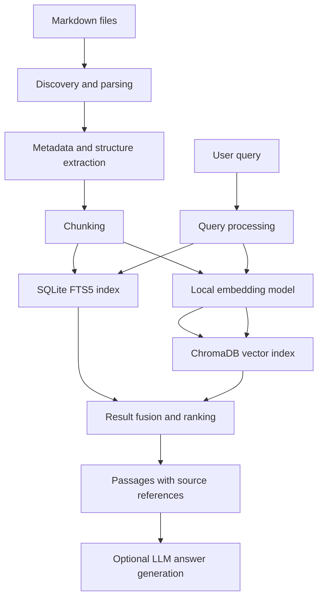

# DocPilot

**A local-first documentation search and knowledge assistant — in early development.**

> **Project status: Early development / pre-v0.1.** Basic Markdown ingestion is available. Search, indexing, answer generation, and a standalone CLI are still planned. DocPilot is not production-ready.

DocPilot is an open-source engineering project to explore how conventional search, embeddings, hybrid retrieval, retrieval-augmented generation (RAG), and eventually bounded agentic workflows can make technical documentation easier to navigate and verify.

## Why DocPilot?

Technical knowledge often lives across Markdown guides, API references, architecture decisions, and runbooks. Exact keyword matching is valuable, but engineers may describe a problem differently from the terms used in documentation. LLM-generated answers can help summarize evidence, but they must remain traceable to the source.

DocPilot will investigate how to combine **lexical precision**, **semantic retrieval**, and **inspectable source references** without requiring a hosted service for core search.

## Goals

- Index local Markdown documentation while preserving headings, code blocks, and source locations.
- Support exact-term search and semantic search, then evaluate hybrid ranking.
- Return relevant passages with document paths and section references.
- Optionally generate grounded answers with citations and explicit uncertainty.
- Keep the core system local-first, low-cost, inspectable, and reproducible.
- Measure retrieval quality and performance rather than relying on demos.

## Proposed v0.1 architecture



See [ARCHITECTURE.md](ARCHITECTURE.md) for the detailed proposed design and unresolved decisions.

## Planned technology stack

| Area | Initial candidate | Purpose |
| --- | --- | --- |
| Application | Python | Parsing, indexing, and search orchestration |
| Source format | Markdown | Version-controlled technical documentation |
| Lexical retrieval | SQLite FTS5 | Exact identifiers and keyword matching |
| Vector retrieval | ChromaDB | Semantic similarity search |
| Embeddings | Local model (TBD) | Offline-capable vector generation |
| Answer generation | Optional local or configured LLM | Evidence-backed synthesis |
| Interface | CLI first (planned) | Simple experimentation and evaluation |
| Tests/evaluation | Python tests + query dataset | Quality, latency, and regressions |

These are **proposed choices**, not validated benchmarks or installed dependencies.

## Roadmap

### v0.1 — Search and RAG (planned)

- [ ] Markdown discovery, parsing, and metadata extraction
- [ ] Structure-aware chunking and source mapping
- [ ] SQLite FTS5 indexing and lexical search
- [ ] Local embedding generation and ChromaDB indexing
- [ ] Hybrid retrieval and ranking experiments
- [ ] Source-linked results and optional cited answers
- [ ] Reproducible evaluation set and baseline metrics

### v0.2 — Documentation intelligence (exploratory)

- [ ] Duplicate and overlapping content detection
- [ ] Staleness and conflict signals with human verification
- [ ] Broken references and quality checks
- [ ] Incremental indexing and change handling

### v0.3 — Agentic workflows (exploratory)

- [ ] Evaluate agents against simpler deterministic workflows
- [ ] Read-only documentation investigation tools
- [ ] Human-reviewed documentation change proposals
- [ ] Tool permissions, auditability, and safety checks

## Getting started

DocPilot currently supports loading local Markdown documents. Search, indexing, and a standalone command-line interface are not implemented yet. You can run the ingestion example through the test suite.

### 1. Open the project directory

Run the following commands from the repository root—the directory containing `README.md` and `requirements.txt`. You will need Python installed and available in your terminal.

### 2. Create and activate a virtual environment

A virtual environment keeps this project's Python packages separate from other projects.

**macOS / Linux:**

```bash
python -m venv venv
source venv/bin/activate
```

If your system uses `python3` instead of `python`, use `python3 -m venv venv` to create the environment.

**Windows PowerShell:**

```powershell
python -m venv venv
.\venv\Scripts\Activate.ps1
```

Create the environment before activating it. If `source venv/bin/activate` reports "no such file or directory," confirm you are in the project root and run `python -m venv venv` first.

For later sessions, you only need to activate the existing environment.

### 3. Install dependencies

With the virtual environment active:

```bash
python -m pip install -r requirements.txt
```

The current dependency file installs `pytest`, the tool used to run the tests. Markdown loading uses Python's standard library; no API keys or external services are required.

### 4. Run the tests

```bash
python -m pytest -v
```

The tests cover loading sample documents, ignoring empty files, finding Markdown files in nested directories, and ignoring non-Markdown files.

### 5. Run the ingestion example with visible output

```bash
python -m pytest tests/test_loader.py::test_load_sample_documents -v -s
```

The example loads Markdown files from `examples/sample-docs/` and prints each document's title, relative source path, character count, and extension, followed by the total number loaded.

The loader uses the first `# ` heading as the document title, falling back to the filename without its extension when no such heading exists.

To run all tests with printed output:

```bash
python -m pytest -v -s
```

`-v` shows individual test names; `-s` displays output that pytest normally hides.

### 6. Leave the virtual environment

```bash
deactivate
```

### Repository layout

The ingestion code, tests, and sample documents are available. The layout below also includes proposed directories for future work.

```text
docpilot/
├── README.md
├── ARCHITECTURE.md
├── src/docpilot/
├── tests/
├── examples/sample-docs/
├── benchmarks/
├── docs/decisions/
├── docs/experiments/
└── blog/
    ├── drafts/
    ├── engineering-log/
    └── assets/
```

## How success will be evaluated

Initial experiments should include representative questions with annotated relevant passages. Planned measurements include **Recall@k**, **MRR**, query latency, indexing time, memory use, and (for generated answers) citation support and faithfulness. No results are available yet.

## Engineering blog series

**Building DocPilot: From Documentation Search to Agentic Knowledge Systems** follows the project from proposed architecture through implementation, experiments, failures, and lessons learned.

- [Part 1 — Why I'm Building DocPilot](https://ai-content-utilties.hashnode.dev/why-i-m-building-docpilot-from-documentation-search-to-ai-powered-knowledge-systems)
- Part 2 (planned) — From Markdown Files to Searchable Documents

## Design principles

**Local-first · Inspectable retrieval · Evidence-backed answers · Low operational complexity · Open-source learning**

## Contributing and license

Contributing guidelines and a license have **not yet been selected**. Do not assume this repository has an open-source license until a `LICENSE` file is added. Contributions and public reuse will be governed by the license once chosen.

---

*DocPilot is a learning-driven engineering project. Planned capabilities will be updated as implementation and evaluation produce evidence.*
