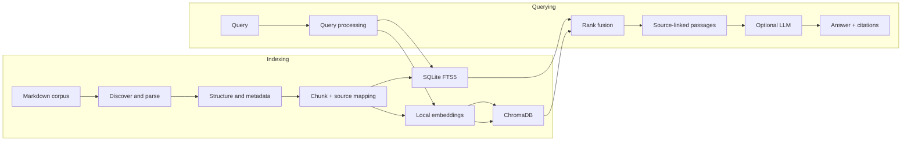
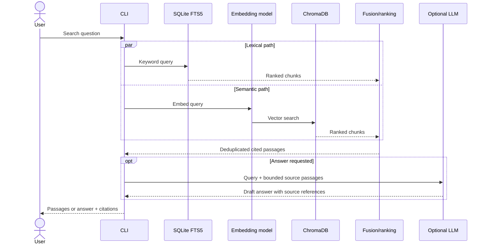

# DocPilot — Proposed System Architecture

**Status:** Design proposal / pre-v0.1  
**Scope:** Local-first Markdown search, hybrid retrieval, and optional evidence-backed RAG  
**Last updated:** 2026-10-31

> This document describes the **intended architecture**, not an existing implementation. Components, interfaces, and data models below are candidates to validate through experiments.

## 1. Problem and design goals

Engineering documentation spans Markdown guides, API references, architecture decisions, and operational runbooks. Exact-match search can miss conceptual matches; semantic retrieval can miss exact technical identifiers; generated answers can be convincing without sufficient support.

DocPilot aims to provide:

1. Local indexing of Markdown with meaningful structural boundaries.
2. Lexical, semantic, and hybrid retrieval over the same source corpus.
3. Inspectable passages with stable references to source documents.
4. Optional LLM synthesis constrained by retrieved evidence.
5. Reproducible evaluation and manageable operational complexity.

### Non-goals for v0.1

- Autonomous repository modification or deployment actions.
- Multi-tenant access control and enterprise operations.
- PDF/OCR ingestion and arbitrary web crawling.
- Training or fine-tuning a foundation model.
- Guaranteeing answer correctness solely by attaching citations.

## 2. High-level architecture

**Two independent workflows:** indexing prepares a corpus; querying retrieves from the indexes. The embedding model is reused to embed queries using the same model/version as indexed chunks. The CLI is the proposed initial interface.

## 3. Indexing pipeline

### 3.1 File discovery

- Traverse an explicitly configured documentation root.
- Include Markdown (`.md`) files initially; ignore configured paths and hidden/generated directories where appropriate.
- Record canonical relative paths, sizes, modification times, and content hashes.
- Avoid path traversal outside the configured root; define symlink behavior explicitly.

### 3.2 Parsing and structure

- Extract heading hierarchy, paragraphs, fenced code, lists, tables, and links.
- Preserve document title and section breadcrumbs.
- Maintain original file/section/line references wherever practical.
- Handle malformed Markdown, encoding errors, and empty documents predictably.

### 3.3 Chunking

Start with two comparable strategies:

- **Baseline:** fixed token/character windows with configurable overlap.
- **Candidate:** heading-aware chunks that keep relevant prose and code examples together.

Each chunk should carry a source path, heading path, positional information, content hash, and chunking version. Chunking must not silently lose text. Oversized sections may require deterministic sub-splitting.

### 3.4 Dual indexing

- **SQLite FTS5:** searchable chunk text plus metadata mapping; suited to identifiers and lexical queries.
- **ChromaDB:** embeddings and metadata keyed to the same chunk identity; suited to semantic queries.

Store the authoritative source mapping in a consistent metadata store (SQLite is a candidate). Define stable IDs and an update strategy before implementing incremental reindexing. Rebuild or reconcile both indexes if one update fails.

## 4. Query and retrieval pipeline

### 4.1 Lexical search

Use FTS5 ranking as a baseline; investigate tokenization and treatment of code identifiers, punctuation, and exact-match terms.

### 4.2 Semantic search

Choose a local embedding model after testing quality, speed, and resource requirements. The query and corpus must use compatible embeddings. Model changes require a planned re-embedding procedure.

### 4.3 Hybrid fusion

Compare lexical-only, semantic-only, and hybrid results on the same labeled queries. **Reciprocal Rank Fusion (RRF)** is an initial candidate because raw lexical and vector scores are not directly comparable. Deduplicate by chunk ID; preserve provenance and source references.

### 4.4 Optional answer generation

The LLM receives the query and a bounded set of retrieved passages with identifiers. Its output should distinguish supported statements from uncertainty and cite source passages. Citation presence is not proof of faithfulness: evaluate support separately. Search-only operation must remain possible.

## 5. Proposed logical data model

These are conceptual records, **not finalized database schemas**.

| Entity | Proposed fields | Purpose |
| --- | --- | --- |
| Document | `document_id`, `relative_path`, `content_hash`, `title`, `indexed_at` | Source identity and change detection |
| Chunk | `chunk_id`, `document_id`, `heading_path`, `text`, `start_line`, `end_line`, `chunker_version` | Retrieval unit and traceability |
| Index metadata | `chunk_id`, `embedding_model_id`, `index_version`, `updated_at` | Cross-index consistency |
| Search result | `chunk_id`, `source_path`, `heading_path`, `rank`, `retrieval_methods` | Inspectable response |
| Evaluation case | `query_id`, `query`, `relevant_chunk_ids`, `category` | Reproducible retrieval tests |

Line ranges may be approximate when Markdown normalization changes formatting; verify their accuracy before treating them as precise citations.

## 6. Component responsibilities

| Component | Responsibility | Important boundary |
| --- | --- | --- |
| Corpus reader | Discover and load local files | No uncontrolled filesystem traversal |
| Markdown parser | Preserve structural elements | No embedding or LLM dependency |
| Chunker | Create retrievable units and provenance | Versioned, deterministic output |
| Index manager | Coordinate FTS5 and ChromaDB updates | Detect partial index failures |
| Retriever | Execute lexical and vector searches | No answer fabrication |
| Ranker | Fuse, deduplicate, and order passages | Evaluation-driven choices |
| Answerer (optional) | Summarize bounded retrieved evidence | Never treated as source of truth |
| CLI (planned) | Index, search, and inspect results | Thin interface over core modules |
| Evaluator | Measure relevance and performance | Reproducible datasets and configs |

## 7. Key design decisions and alternatives

| Decision | Initial proposal | Alternative to evaluate | Why not settled yet |
| --- | --- | --- | --- |
| Search | FTS5 + ChromaDB | FTS-only or other vector store | Complexity vs relevance unknown |
| Chunking | Heading-aware | Fixed-size with overlap | Needs measured retrieval outcomes |
| Embeddings | Local model | Hosted model | Quality/resource/privacy trade-off |
| Ranking | RRF | Weighted fusion or reranker | Depends on query set and latency |
| Interface | CLI | Web UI/API | Prioritize retrieval evaluation |
| Answering | Optional LLM | Search-only | Grounded answers may add limited value |

## 8. Evaluation plan

Build an annotated set of approximately 30–50 realistic queries as an initial experiment, including exact identifiers, paraphrases, multi-section questions, and queries with no supported answer. This is a **proposed dataset size**, not an existing benchmark.

Track:

- **Recall@k:** fraction of relevant passages retrieved within the first `k` results.
- **MRR:** rank of the first relevant passage across queries.
- **Latency:** query processing and retrieval timings, reported with environment details.
- **Indexing cost:** elapsed time, storage size, and memory use.
- **Citation support:** whether answer claims are actually supported by cited passages.
- **Failure cases:** irrelevant matches, missing evidence, malformed documents, and inconsistent index state.

Record corpus version, embedding model, chunking parameters, index settings, code commit, and hardware with every result. No performance claims should be published until measured.

## 9. Reliability, privacy, and security

- Default to local documents and local indexing; optional external LLM calls must be explicit.
- Treat document content as **untrusted input**, especially when passed to an LLM; it must not override system or tool instructions.
- Do not expose secrets found in documentation to hosted models without user consent and controls.
- Use read-only source ingestion for v0.1; avoid automatic document modification.
- Handle deletions, failed indexing, and partial writes to prevent stale or mismatched search results.
- Make model versions, chunker versions, and index schema versions inspectable.

## 10. Development milestones

### v0.1 — Retrieval foundation

1. **Markdown ingestion:** discovery, parsing, source mapping, tests.
2. **Chunking:** fixed-size baseline vs heading-aware experiment.
3. **Lexical retrieval:** SQLite FTS5 index and CLI queries.
4. **Semantic retrieval:** local embeddings and ChromaDB.
5. **Hybrid search:** fusion and comparative evaluation.
6. **Optional RAG:** bounded context, source references, faithfulness checks.
7. **Evaluation report:** metrics, reproducibility, failures, limitations.

### v0.2 — Documentation intelligence (candidate)

Investigate duplicate/overlapping content, staleness signals, conflicting guidance, link validation, and incremental updates. Require human review for ambiguous findings.

### v0.3 — Agentic workflows (candidate)

First compare deterministic tools against agentic orchestration. If agents prove useful, limit their permissions, log tool calls, keep default operations read-only, and require approval before applying proposed edits.

## 11. Open questions

1. Which Markdown parser best preserves code fences, tables, and source positions?
2. What chunk sizes and boundaries work across prose and configuration-heavy docs?
3. How should exact identifiers be tokenized and ranked?
4. Which local embedding model meets practical memory and latency constraints?
5. Does hybrid fusion outperform each baseline on a representative query set?
6. How should stable chunk IDs behave after document edits?
7. What constitutes sufficient evidence for a generated answer?
8. When does the complexity of an agent improve outcomes over a fixed workflow?

## 12. Immediate next step

Implement and test **Markdown discovery and structural parsing** on a small, version-controlled sample corpus. Produce document records with path, heading hierarchy, code blocks, and source locations. Capture an engineering log and publish the findings as Part 2 of the [Building DocPilot blog series](https://ai-content-utilties.hashnode.dev/why-i-m-building-docpilot-from-documentation-search-to-ai-powered-knowledge-systems).

---

*Architecture will evolve based on experiments. Keep this document aligned with actual implementation status, not aspirational feature lists.*
